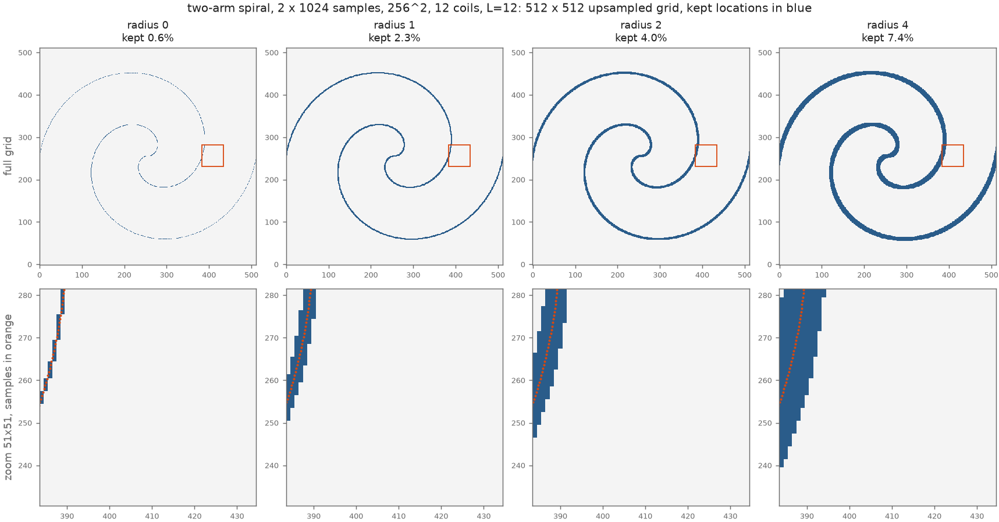
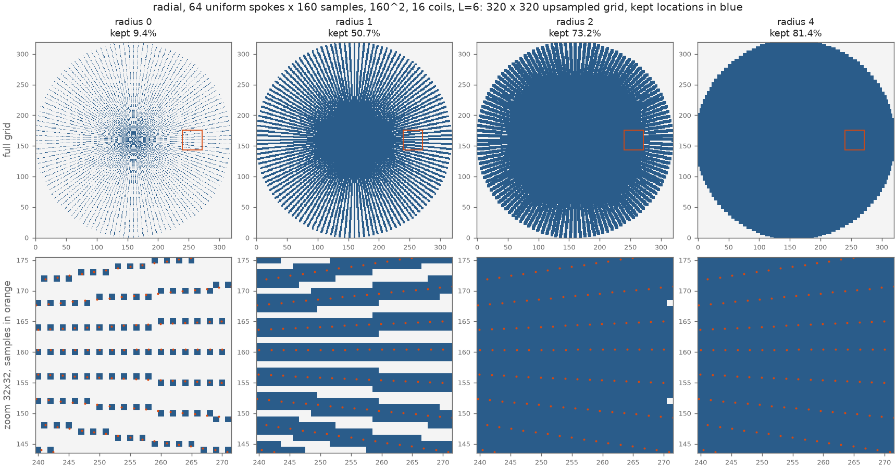
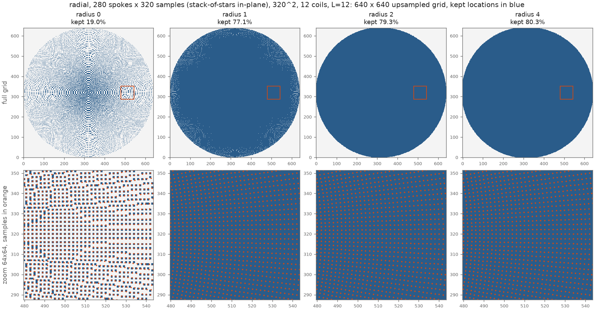
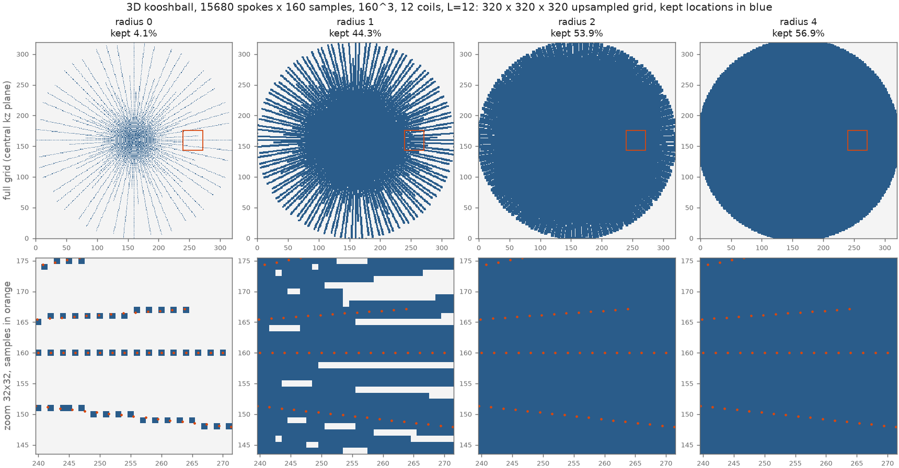

# Neighbourhood mask

This report tests the k-space mask of the masked Toeplitz operator: keep only the grid locations
close to the samples. It measures how much of the upsampled grid the mask keeps at each radius and
how accurate the masked operator is. CG convergence is not tested; only single-operator accuracy
is. The code is [`neighbour_mask.py`](https://github.com/mikecjz/MR_AHA/blob/b4fb00c/benchmarks/neighbour_mask.py). Raw numbers are in
`results/pact400-recon3/neighbour_mask_<problem>.json`, measured on a TITAN RTX.

> **Outcome.** The neighbourhood mask is the library's `calc_mask`, with `mask_radius = 2` as the
> default. The library implementation gives masks bit-identical to the CuPy reference used here.
> It was also checked on the full 377-spoke 2D radial data (160², not one of the four problems
> below):
>
> | 377-spoke radial, 160² | r = 1 | r = 2 (default) | r = 3 | r = 4 | r = 6 | r = 8 |
> |---|---|---|---|---|---|---|
> | grid kept | 79.2 % | 80.3 % | 81.3 % | 82.3 % | 84.2 % | 85.8 % |
> | image error ÷ out | 9.5·10⁻⁵ | 5.3·10⁻⁵ | 3.8·10⁻⁵ | 2.1·10⁻⁵ | 1.2·10⁻⁵ | 5.9·10⁻⁶ |
> | white-noise error ÷ out | 6.9·10⁻³ | 4.2·10⁻³ | 2.8·10⁻³ | 2.0·10⁻³ | 1.2·10⁻³ | 7.6·10⁻⁴ |

## Summary

The table gives the share of the grid kept and the operator error on the image input (÷ out) at
three radii, next to the error of the unmasked operator.

| problem | r = 2 (default): kept / error | r = 4: kept / error | r = 8: kept / error | unmasked error (floor) |
|---|---|---|---|---|
| 2-arm spiral | 4.0 % / 2.9·10⁻² | 7.4 % / 1.6·10⁻² | 14.2 % / 3.1·10⁻³ | 5.2·10⁻⁷ |
| 64-spoke radial | 73.2 % / 5.3·10⁻⁴ | 81.4 % / 6.9·10⁻⁵ | 85.0 % / 3.2·10⁻⁵ | 1.0·10⁻⁶ |
| 280-spoke radial | 79.3 % / 3.3·10⁻⁶ | 80.3 % / 2.0·10⁻⁶ | 82.3 % / 1.5·10⁻⁶ | 1.2·10⁻⁶ |
| 15680-spoke kooshball | **53.9 % / 4.3·10⁻⁶** | 56.9 % / 4.1·10⁻⁶ | 62.8 % / 4.0·10⁻⁶ | ≈ 3.8·10⁻⁶ ¹ |

¹ The unmasked 3D kernel does not fit next to the test data on the 24 GB TITAN RTX. The value given
is the unmasked Toeplitz-vs-NUFFT difference measured on the L40S in the [main study](results.md).

* **Dense trajectories (280 radial spokes, kooshball): r = 2 is enough.** The error is 3.3·10⁻⁶
  for the 280-spoke radial problem and 4.3·10⁻⁶ in 3D, within a factor of three of the unmasked
  operator. In 3D r = 2 keeps **53.9 %** of the grid, which is close to the volume of the sampled
  sphere, π/6 = 52.4 % of the cube. Larger radii add grid but hardly any accuracy.
* **Fewer spokes need a larger radius.** With 64 spokes the error at r = 2 is 5.3·10⁻⁴; it falls
  to 6.9·10⁻⁵ at r = 4 and 3.2·10⁻⁵ at r = 8, where 85 % of the grid is kept.
* **Sparse trajectory (two-arm spiral): the error falls slowly with the radius.** r = 2 keeps 4 %
  of the grid at 2.9·10⁻², and r = 8 still gives 3·10⁻³ at 14 % kept. Here the kernel's energy
  away from the arms lies in tails that run parallel to the kx and ky axes, and a box around each
  sample does not follow those tails.
* **r = 0 (nearest grid point only) is never usable.** Its error is about 10⁻¹ in every problem.
  Samples fall between grid points, so the kernel around a sample is spread over at least the
  neighbouring cells. For radial and kooshball sampling, r = 1 already leaves gaps between spokes
  near the edge of k-space.
* **White noise** is harder, because it puts energy at frequencies that the mask drops. At r = 2
  its error is 4·10⁻² (spiral), 3·10⁻² (64 spokes), 8·10⁻³ (280 spokes) and 1.5·10⁻³ (kooshball).

**Recommendation.** For dense radial and 3D trajectories, use r = 2–4; in 3D this saves almost
half of the kernel. The cost of the mask is a single scatter and a max-filter, with no NUFFT. For
sparse trajectories such as few-arm spirals, raise the radius and check the accuracy your
application needs: the mask does not reach 10⁻⁵-level accuracy on the spiral while keeping a small
share of the grid.

## The mask

1. Map every sample k (in radians) to its nearest point on the upsampled M = 2N grid:
   `round(k·M/2π) + M/2`, modulo M.
2. Mark those points.
3. Dilate the marks with a (2r+1)ᵈ box, so that every point within r cells of a marked point is kept
   (Chebyshev distance, periodic edges).

r = 0 keeps only the nearest grid point of each sample. Note that on the 2× grid, samples along a
radial spoke are 2 cells apart.

## Test problems

| problem | trajectory | matrix | coils | L | input image |
|---|---|---|---|---|---|
| spiral | 2-arm Archimedean spiral, 2 × 1024 samples, 1 revolution ([`make_spiral.py`](https://github.com/mikecjz/MR_AHA/blob/b4fb00c/benchmarks/make_spiral.py)) | 256² | 12 | 12 | synthetic ellipses; synthetic coils and rank-3 Gram blocks |
| radial64 | 64 spokes × 160 samples, every 377/64-th spoke of `data/human_C-35_2D_radial.mat` (uniform over 180°) | 160² | 16 | 6 | stored coefficients `x` |
| radial280 | 280 spokes × 320 samples, the in-plane trajectory of `data/AhAx_test_toeplitz.mat` | 320² | 12 | 12 | middle slice of `Ahb`, with the kz = 0 Gram blocks and middle-slice coils |
| kooshball | 15680 spokes × 160 samples, synthetic ([`make_kooshball.py`](https://github.com/mikecjz/MR_AHA/blob/b4fb00c/benchmarks/make_kooshball.py)) | 160³ | 12 | 12 | `x_true` |

radial280 is run as a single 2D plane. A stack-of-stars mask is this in-plane mask repeated over kz,
so its kept fraction is the same.

## Error measures

Each masked Toeplitz $A^HA$ is compared with the NUFFT $A^HA$ (cufinufft, eps 10⁻⁶) on two
inputs: the image above and complex white noise. The noise input is the worst case, because it puts
equal energy at every spatial frequency. Each error is normalised in two ways:

* **÷ out:** $\|T_\text{mask}x - A^HAx\| / \|A^HAx\|$, relative to the operator's output;
* **÷ in:** $\|T_\text{mask}x - A^HAx\| / (\|A^HA\|\,\|x\|)$, relative to the input times the
  operator norm, which is estimated by power iteration. Unlike ÷ out, this is not inflated when the
  operator itself makes the input small, as it does for sparse trajectories.

The "unmasked" row is the floor: the Toeplitz embedding error plus the NUFFT tolerance.

## Results per problem

Each figure shows the mask at radii 0, 1, 2 and 4. The top row is
the full upsampled grid (for 3D, the central kz plane). The bottom row zooms in on the orange box,
at about 60 % of k_max along +kx, with the samples in orange; for 3D only samples within half a
cell of that plane are shown. Kept locations are blue.

### Two-arm spiral (256², 512² grid)

| mask | grid kept | image ÷ out | image ÷ in | white noise ÷ out | white noise ÷ in |
|---|---|---|---|---|---|
| neighbourhood r = 0 | 0.6% | 1.3·10⁻¹ | 1.4·10⁻² | 1.8·10⁻¹ | 1.8·10⁻³ |
| neighbourhood r = 1 | 2.3% | 4.3·10⁻² | 4.5·10⁻³ | 6.0·10⁻² | 6.2·10⁻⁴ |
| neighbourhood r = 2 | 4.0% | 2.9·10⁻² | 3.1·10⁻³ | 3.9·10⁻² | 4.0·10⁻⁴ |
| neighbourhood r = 3 | 5.7% | 1.9·10⁻² | 2.0·10⁻³ | 2.6·10⁻² | 2.7·10⁻⁴ |
| neighbourhood r = 4 | 7.4% | 1.6·10⁻² | 1.6·10⁻³ | 2.0·10⁻² | 2.0·10⁻⁴ |
| neighbourhood r = 6 | 10.8% | 8.0·10⁻³ | 8.4·10⁻⁴ | 1.4·10⁻² | 1.4·10⁻⁴ |
| neighbourhood r = 8 | 14.2% | 3.1·10⁻³ | 3.3·10⁻⁴ | 9.9·10⁻³ | 1.0·10⁻⁴ |
| unmasked | 100.0% | 5.2·10⁻⁷ | 5.4·10⁻⁸ | 4.8·10⁻⁷ | 5.0·10⁻⁹ |

### 64-spoke radial (160², 320² grid)

| mask | grid kept | image ÷ out | image ÷ in | white noise ÷ out | white noise ÷ in |
|---|---|---|---|---|---|
| neighbourhood r = 0 | 9.4% | 1.4·10⁻¹ | 1.1·10⁻² | 2.8·10⁻¹ | 4.9·10⁻³ |
| neighbourhood r = 1 | 50.7% | 2.6·10⁻³ | 2.1·10⁻⁴ | 7.9·10⁻² | 1.4·10⁻³ |
| neighbourhood r = 2 | 73.2% | 5.3·10⁻⁴ | 4.3·10⁻⁵ | 3.2·10⁻² | 5.6·10⁻⁴ |
| neighbourhood r = 3 | 80.2% | 1.4·10⁻⁴ | 1.1·10⁻⁵ | 1.0·10⁻² | 1.8·10⁻⁴ |
| neighbourhood r = 4 | 81.4% | 6.9·10⁻⁵ | 5.6·10⁻⁶ | 7.4·10⁻³ | 1.3·10⁻⁴ |
| neighbourhood r = 6 | 83.3% | 4.0·10⁻⁵ | 3.2·10⁻⁶ | 5.1·10⁻³ | 9.0·10⁻⁵ |
| neighbourhood r = 8 | 85.0% | 3.2·10⁻⁵ | 2.6·10⁻⁶ | 4.2·10⁻³ | 7.5·10⁻⁵ |
| unmasked | 100.0% | 1.0·10⁻⁶ | 8.4·10⁻⁸ | 1.5·10⁻⁶ | 2.6·10⁻⁸ |

### 280-spoke radial (320², 640² grid)

| mask | grid kept | image ÷ out | image ÷ in | white noise ÷ out | white noise ÷ in |
|---|---|---|---|---|---|
| neighbourhood r = 0 | 19.0% | 1.2·10⁻¹ | 2.5·10⁻² | 3.2·10⁻¹ | 2.4·10⁻³ |
| neighbourhood r = 1 | 77.1% | 2.6·10⁻⁵ | 5.6·10⁻⁶ | 4.2·10⁻² | 3.2·10⁻⁴ |
| neighbourhood r = 2 | 79.3% | 3.3·10⁻⁶ | 7.0·10⁻⁷ | 7.7·10⁻³ | 5.9·10⁻⁵ |
| neighbourhood r = 3 | 79.8% | 2.3·10⁻⁶ | 4.9·10⁻⁷ | 5.6·10⁻³ | 4.3·10⁻⁵ |
| neighbourhood r = 4 | 80.3% | 2.0·10⁻⁶ | 4.3·10⁻⁷ | 4.5·10⁻³ | 3.5·10⁻⁵ |
| neighbourhood r = 6 | 81.4% | 1.6·10⁻⁶ | 3.5·10⁻⁷ | 3.4·10⁻³ | 2.6·10⁻⁵ |
| neighbourhood r = 8 | 82.3% | 1.5·10⁻⁶ | 3.2·10⁻⁷ | 2.8·10⁻³ | 2.2·10⁻⁵ |
| unmasked | 100.0% | 1.2·10⁻⁶ | 2.5·10⁻⁷ | 1.5·10⁻⁶ | 1.2·10⁻⁸ |

### 15680-spoke kooshball (160³, 320³ grid)

| mask | grid kept | image ÷ out | image ÷ in | white noise ÷ out | white noise ÷ in |
|---|---|---|---|---|---|
| neighbourhood r = 0 | 4.1% | 1.2·10⁻¹ | 2.7·10⁻² | 1.6·10⁻¹ | 1.2·10⁻⁴ |
| neighbourhood r = 1 | 44.3% | 2.0·10⁻⁵ | 4.4·10⁻⁶ | 1.5·10⁻² | 1.1·10⁻⁵ |
| neighbourhood r = 2 | 53.9% | 4.3·10⁻⁶ | 9.5·10⁻⁷ | 1.5·10⁻³ | 1.1·10⁻⁶ |
| neighbourhood r = 3 | 55.5% | 4.1·10⁻⁶ | 9.1·10⁻⁷ | 1.1·10⁻³ | 8.1·10⁻⁷ |
| neighbourhood r = 4 | 56.9% | 4.1·10⁻⁶ | 8.9·10⁻⁷ | 8.8·10⁻⁴ | 6.6·10⁻⁷ |
| neighbourhood r = 6 | 59.9% | 4.0·10⁻⁶ | 8.8·10⁻⁷ | 6.7·10⁻⁴ | 5.0·10⁻⁷ |
| neighbourhood r = 8 | 62.8% | 4.0·10⁻⁶ | 8.7·10⁻⁷ | 5.4·10⁻⁴ | 4.1·10⁻⁷ |
| unmasked | 100.0% | did not fit in 24 GB | | | |
